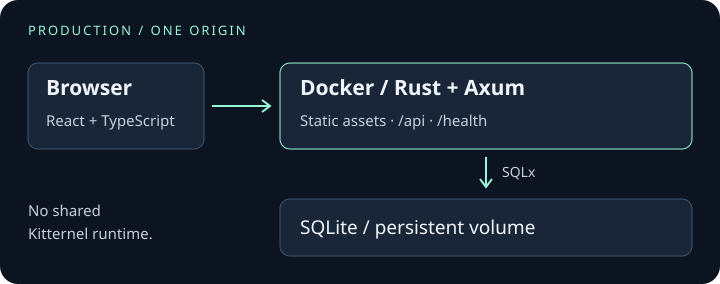

<div align="center">

<p align="center">
  
</p>


### Your stack. Your code. Your rules.

A lightweight, Docker-first full-stack starter built with **Rust, React and SQLite**.<br>
Generate an independent application and make it entirely yours.

**Rust / Axum** · **React / TypeScript** · **SQLite / SQLx** · **Vite / Tailwind CSS**

[Get started](#quick-start) · [Architecture](#architecture) · [Alpha notes](docs/releases/v0.1.0-alpha.1.md) · [Contribute](CONTRIBUTING.md)

**Public alpha preparation — `v0.1.0-alpha.1`**<br>
Foundation preview. Authentication is not included. No production-readiness claim.

</div>

---

## Build it. Own it.

Kitternel gives you a complete application, then gets out of the way. The generated
source belongs in your own repository, with its own builds, tests, documentation
and deployment. Keep the initial choices or evolve them for your application.

No Kitternel CLI, shared runtime, upstream remote or update service is required
after generation. You own dependency updates and operational decisions too.

## What you get

| Application | Delivery and maintenance |
| --- | --- |
| **Rust + Axum + Tokio** — typed API, safe errors, health endpoints and bounded shutdown | **One Docker runtime** — compiled frontend and Rust backend; no Node process in production |
| **React + TypeScript + Vite + Tailwind** — responsive UI, loading/error/retry states, same-origin API | **Persistent SQLite** — SQLx migrations, WAL and a dedicated local data volume |
| **Tests at several levels** — Rust, component, browser and real-process checks | **Independent CI and security tooling** — pinned tools, explicit gates and scan reports |
| **Owned source** — backend, frontend, both lockfiles, tests and configuration | **Operational handoff** — maintenance guide, consistent backup helpers and independent-volume restore drills |

## Quick start

Use a POSIX shell with **Git**, **Python 3.11+** (including its SQLite module),
**Docker with BuildKit**, **Docker Compose v2** and **curl**. Linux/amd64 is the
validated runtime target. Generation alone needs only Python and Git; Docker
builds need no host Rust or Node installation. Downloads require network access.

From a directory where both `kitternel` and the new `garden-notes` destination do
not yet exist:

```sh
git clone https://github.com/NickyBass/kitternel.git
cd kitternel
python3 scripts/create-light.py garden-notes ../garden-notes
cd ../garden-notes
docker build -t garden-notes:local .
docker compose up -d --no-build --wait
curl --fail http://127.0.0.1:8080/health/ready
curl --fail http://127.0.0.1:8080/api/hello
```

Open **[localhost:8080](http://localhost:8080)** on the Docker host. A fresh database
is initialized automatically; the named volume keeps it across container recreation.
If the repository is still private, cloning requires authorized GitHub access.
Use a trusted reviewed commit for reproducible source selection; the clone command
tracks the current default branch, not an immutable release artifact.

Port busy? Use `HOST_PORT=8081 docker compose up -d --no-build --wait`, then change
the curl/browser port to 8081. In a remote environment, localhost refers to that
machine. For inspected TLS proxies, see the documented
[optional build CA secret](docs/deployment/docker.md#build).

Read the generated **README**, **CONTRIBUTING** and **MAINTENANCE** guides next.
Stop with `docker compose stop`; keep the Compose project and data-volume identity
stable. **Do not use `down --volumes` on data you want to keep.**

[Generation rules and file map →](docs/development/CREATE-LIGHT.md)

## Architecture

<p align="center">
  
</p>

In production, the browser loads compiled React assets and calls relative `/api`
and `/health` URLs. A single Rust process serves both and accesses SQLite through
SQLx. The database directory is mounted separately from the application image.

During development, Vite provides hot reload on port 5173 and proxies API/health
requests to Rust on 8080. Build the frontend once before starting Rust, even when
using Vite. Native work needs the selected Rust toolchain, C compiler/linker,
Node and npm versions listed in [CONTRIBUTING](CONTRIBUTING.md#prerequisites-and-first-run).

## Independent by design

```text
garden-notes/
├── backend/         Rust API, migrations, tests, Cargo.lock
├── frontend/        React UI, unit/browser tests, package-lock.json
├── scripts/         Smoke checks, pin/security tools, backup/restore helpers
├── .github/         Own CI and security workflows
├── Dockerfile       Multi-stage build, single application runtime
├── compose.yaml     Local persistent data volume
└── *.md             README, CONTRIBUTING, MAINTENANCE, SECURITY, AGENTS
```

Generation starts no Git history and adds no remote. Initialize your own repository
using the generated CONTRIBUTING guide. Maintain it without the Kitternel checkout;
there is no automatic upstream synchronization or inherited support service.
The [MIT notice](LICENSE) is retained in generated applications.

## Develop and maintain

| Goal | Guide |
| --- | --- |
| Work on Kitternel, run checks or add migrations | [Contributing](CONTRIBUTING.md) |
| Understand configuration, frontend development and SQLite behavior | [Light technical reference](docs/development/LIGHT-REFERENCE.md) |
| Build and operate the container | [Docker reference](docs/deployment/docker.md) · [Installation walkthrough](docs/deployment/docker-installation.md) |
| Verify a backup and restore into fresh storage | [Backup and recovery](docs/deployment/backup-restore.md) |
| Interpret scanner findings and policy | [Security scanning](docs/development/SECURITY-SCANNING.md) |
| Review direction and validation evidence | [Roadmap](docs/development/DOCKER-FIRST-ROADMAP.md) · [Verification](docs/development/verification.md) |

Generated applications include their own **MAINTENANCE.md** with dependency updates,
image retention, migration compatibility and recovery procedures.

## Alpha scope and security

The starter currently exposes public, read-only greeting and health endpoints.
**Authentication, authorization, sessions and CSRF defenses are absent.** Add an
appropriate security design before building protected functionality.

The validated deployment model is **one Linux/amd64 instance**, local
SQLite-compatible storage and serialized replacements. Windows/macOS Docker,
ARM, Dokploy and Coolify deployments are not verified support claims. Configure
TLS at a trusted reverse proxy, storage permissions, monitoring, off-host backups
and periodic recovery drills for your own application.

Security tooling reports findings; a passing gate does not prove safety. The
current choices include a temporary upstream SQLx Git pin, a development minimatch
override and documented runtime package risks.
[Known risks and evidence limits](docs/releases/ALPHA-LIMITATIONS.md) records their
scope and dates. Alpha compatibility and upgrade expectations are in the
[release notes](docs/releases/v0.1.0-alpha.1.md).

Read [SECURITY.md](SECURITY.md) before reporting a vulnerability. Generated owners
must configure their own private contact and maintain their own dependencies.

## Contributing and license

Focused contributions are welcome through [CONTRIBUTING.md](CONTRIBUTING.md).
[AGENTS.md](AGENTS.md) describes the repository's AI collaboration conventions.
Kitternel is [MIT licensed](LICENSE); retain the notice when using generated source.
Third-party software carries its own license obligations.
